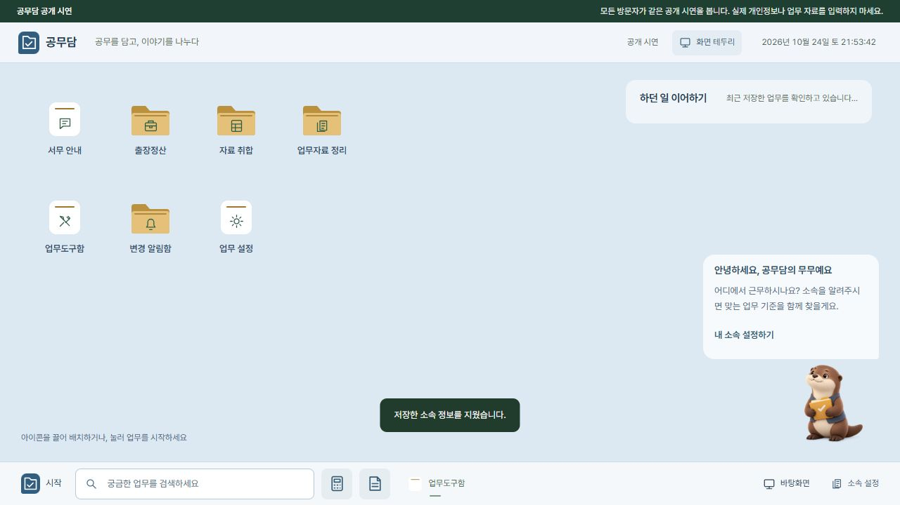
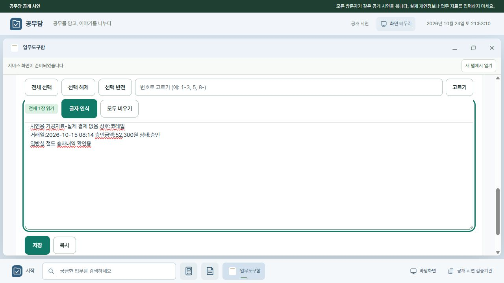

# B안 연결·Workers 배포 검증 — 2026-10-24

공개 주소: **https://gongmudam.visanu81.workers.dev**

기존 v69의 런타임 파일 483개는 변경하지 않았습니다. 별도의 연결 모듈로 B안에서 실제 업무 화면을 열고, Workers 정적 자산과 전용 VPC 서비스를 통해 Windows 공개 시연 실행본에 연결했습니다. PC 없이 Python 업무 기능까지 실행되는 이식은 아닙니다.

## 실제 공개 주소에서 확인

| 확인 | 결과 |
|---|---|
| 첫 접속 → B안 | 고정 주소에서 정상 열림 |
| 질문 → 실제 원문 답변 | 경조사휴가 질문에서 국가공무원 별표와 본인 결혼 5일 안내 확인 |
| 소속 전달 | 합성 소속·국가공무원·세종시를 설정한 뒤 실제 질문에 업무환경이 함께 전달됨 |
| 등록 공개 자료 | 31건 모두 활성·현재 원문 해시 일치 |
| 모델 전환 | Llama → Gemma 변경 후 선택한 모델이 실제 응답한 것을 확인 |
| 합성 일반출장 | 계산·원본·자료 버전 등 기대값 10개 모두 통과 |
| 도구함 이미지 → PDF | 공개 무무 이미지로 104.9KB PDF 생성, blob 미리보기와 출력 대화상자 확인 |
| 출장 직접 첨부 | 생성 PDF를 참고 첨부로 저장하고 서버 목록 확인 |
| 자료 취합 직접 첨부 | 같은 PDF를 합성 교육 취합 업무에 참고 첨부로 저장 |
| 저장 보존 | 두 업무의 첨부 SHA-256이 같고 서버 재시작 뒤에도 남아 있음 |
| OCR | 번들 합성 영수증에서 75자 인식, WebAssembly 엔진 실제 실행 확인 |
| 최근 업무 | 저장된 출장·교육 취합·합성 폴더를 API로 읽음; 등록 원문 폴더는 제외 |
| 접근 경계 | 임의 PC 폴더 요청 403, 공개 기관 DB 정적 URL 404, 외부 모델 URL 변경 400 |

두 모델의 명시적 연결 검사는 개인·업무 문서 대신 짧은 합성 텍스트로 수행했습니다. Llama는 약 6.3초, Gemma는 약 13.2초 뒤 응답했으며 요청·응답 모델명이 일치했습니다. 모든 업무 질문을 두 모델에 다시 실행했다는 의미는 아닙니다.

직접 첨부는 참고 파일로 시험했으며 기존 거래·취합 행·계산 금액을 자동 반영하지 않았습니다. 합성 교육 업무 생성은 API, PDF 생성·첨부는 실제 공개 브라우저 화면에서 실행했습니다.

첨부 PDF SHA-256: `a85f33b5f953a2c273eaa134890770485c4283aa32f8cbe23e8504bd47f65d5a`

## 자동 검사와 검토

- 연결 모듈 Python 검사 8개 통과: 정적 파일 경계, HTML 연결, 다운로드 바이트 보존, 동작에 필요한 CSP, 실행본 덮어쓰기 방지, 모델 요청 제한, 모델 선택 리비전.
- Workers Node 검사 6개 통과: B안 진입·정적 자산·API 요청/파일 응답·다른 출처 쓰기 차단·업로드 한도·오프라인 오류·리다이렉트.
- 관련 기존 Python 회귀 검사 45개 통과: 공개 모드·업무 상태·질문 안내·시작 흐름·도구함 관련 검사.
- 기관 검색 검사 8개 통과, 변경 JavaScript 문법 검사 통과.
- 고노력 검토에서 발견한 소속 계약, 긴 질문 보존, 모델 검사 제한 누락, 모델 전환 리비전, 도구함 CSP 문제를 수정하고 확인했습니다.
- Graphify 기존 서비스 관계·관련 테스트를 먼저 조회했습니다. 새 연결 모듈은 별도 지도 10개 코드 파일로 갱신했으며 최종 freshness 검사를 통과했습니다. HTML·CSS·동적 메시징 경로는 지도 범위의 한계가 있어 소스와 실제 화면으로 확인했습니다.
- 디자인 탐지의 낮은 대비 2건을 수정했습니다. 아이콘 위·아래 배치와 창 그림자 지적은 사용자가 승인한 바탕화면 디자인으로 유지합니다.

## 범위와 남은 조건

공개 시연은 방문자가 같은 업무 DB를 공유하며, 실제 개인정보·업무자료를 입력하면 안 됩니다. PC·업무 서버·터널이 켜져 있어야 API와 로컬 AI를 사용할 수 있습니다. 부팅 자동 실행은 이번 작업에 포함하지 않았습니다. PC가 꺼졌을 때 정적 B안이 열리는 것과 업무 처리 가능 상태는 구분합니다.

Windows 새 실행본과 실제 공개 URL로 확인했으며, 별도의 물리 PC·모바일 기기에서 시험하지는 않았습니다. v69의 전체 761개 검사를 다시 수행한 것은 아닙니다. Node 개발 도구 설치의 감사 알림(중간 2·높음 1)은 Wrangler 개발 의존성에 남아 있습니다. 이를 해결하기 위해 기능이 없는 과거 Wrangler로 강제 하향하지 않았으며, 해당 도구를 공개 요청 처리 런타임으로 배포하지 않았습니다. TestClient 폐기 예정 경고와 ONNX 초기화 경고는 실행 실패와 구분했습니다.

## 화면 증거

실행·연결 방법은 [배포 안내](DEPLOYMENT.md)를 참고하세요.
