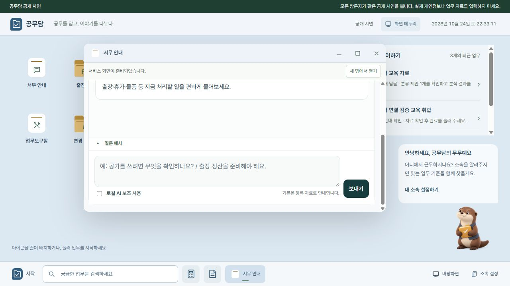

# 업무 창 크기 조절 — 2026-10-24

서버 이전 요청은 취소되어 기존 구조를 유지합니다. 주소는 `gongmudam.visanu81.workers.dev`에 고정하고 Python·로컬 AI는 PC 서버에서 실행합니다. Render 새 서비스나 유료 리소스는 생성하지 않았습니다.

메뉴로 여는 업무 창, 설정, 계산기, 메모장에 공통 크기 조절을 연결했습니다. 가장자리 4곳과 모서리 4곳을 마우스로 끌 수 있고, 손잡이에 초점을 두고 방향키·Shift+방향키를 사용할 수 있습니다. 창은 작업공간과 최소 크기 안에서 조절됩니다. 최대화 중에는 손잡이를 숨기며 작은 화면의 전체 작업공간 배치는 유지합니다.

## 확인 결과

- Node 검사 3개 통과: 8방향, 반대쪽 모서리 고정, 최소 크기·화면 경계·작은 작업공간, 잘못된 입력.
- 실제 브라우저에서 서무 안내 창을 오른쪽 아래로 끌어 860×528에서 698×408로 줄였습니다.
- 왼쪽 위를 끌어 758×423으로 변경했고 오른쪽·아래 기준점이 유지됐습니다.
- 최대화·복원 및 최소화·다시 열기 후 758×423 크기가 유지됐습니다.
- 조절 후 iframe의 포인터 입력이 복구되었고 실제 질문 전달·답변을 확인했습니다.
- 760px 아래에서 기존 입력란이 1px로 좁아지던 규칙은 연결 화면의 CSS에서 보완했습니다. 758×423 창에서 입력란·보내기 버튼이 정상 표시됨을 확인했습니다. 원본 서비스 파일은 변경하지 않았습니다.
- 메모장 방향키 조절 후 536×500이 됐으며 이전 전용 손잡이는 숨겨졌습니다. 메모 본문은 수정하지 않았습니다.
- 변경 JavaScript 문법과 diff 검사를 통과했습니다. 코드 검토에서 중대한 문제는 없었습니다.
- Graphify 영향 조회 후 별도 지도를 갱신하고 최신 상태를 확인했습니다. HTML·CSS와 브라우저 포인터 동작은 직접 확인했습니다.

PC·서버·터널이 꺼져 있을 때 업무 기능을 사용할 수 없는 조건은 그대로입니다. 실행 방법은 [배포 안내](DEPLOYMENT.md)를 참고하세요.

